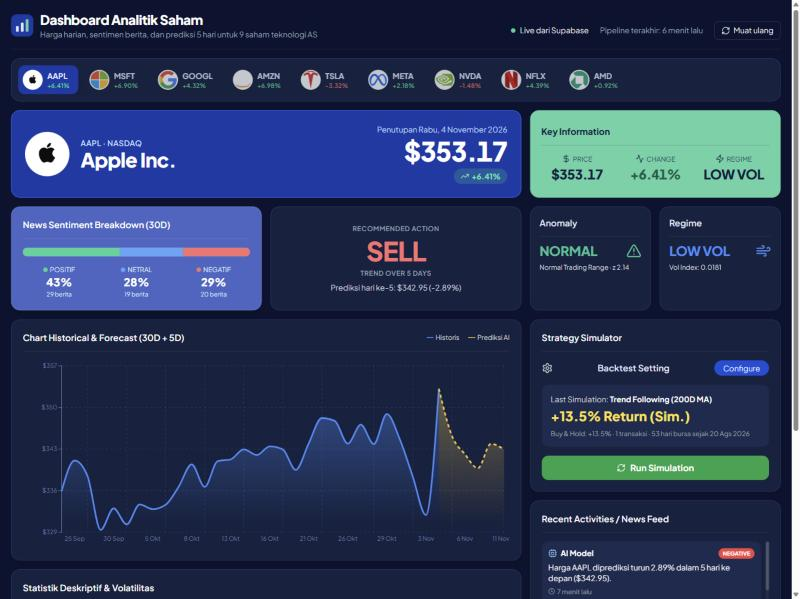

# Stock Analytics Dashboard

React dashboard for the [Stock Market Analytics Pipeline](https://github.com/yunnhn/stock-analytics-pipeline). It reads prices, news
sentiment and 5-day forecasts for 9 U.S. tech stocks from Supabase, which an Apache Airflow
pipeline refreshes every 4 hours.

**Live demo:** https://stock-analytics-dashboard-weld.vercel.app



## Features

- **Price and forecast chart**: 30 days of closing prices with the model's 5-day forecast (Recharts).
- **Recommended action**: BUY / SELL / HOLD from the 5-day forecast trend.
- **News sentiment (30 days)**: positive / neutral / negative share of headlines, plus a news feed
  with sentiment labels.
- **Anomaly status**: 20-day rolling z-score on the closing price, flagged beyond ±3σ.
- **Volatility regime**: LOW / HIGH based on 20-day realized volatility of daily returns.
- **Strategy simulator**: client-side backtest of 200/50-day trend following and a 5/20 moving-average
  crossover, compared with buy-and-hold. No transaction costs.
- **Descriptive statistics**: last session OHLC and 30-day mean, standard deviation, min and max.
- Falls back to clearly labeled demo data when Supabase is unreachable.

Analytics logic lives in [`src/utils/analytics.js`](src/utils/analytics.js).

## Tech stack

React 18, Vite, Tailwind CSS, Recharts, lucide-react, Supabase JS client.

## Running locally

1. Create `.env` in this folder:
   ```
   VITE_SUPABASE_URL=https://<project-ref>.supabase.co
   VITE_SUPABASE_ANON_KEY=<anon public key>
   ```
   Use the **anon** key only. Tables are protected by row-level security and are read-only for
   this key.
2. Install and start:
   ```bash
   npm install
   npm run dev
   ```
3. Open `http://localhost:5173`.

## Deploying

The app is a static site. On Vercel or Netlify, set the two `VITE_` variables above in the project
settings and use `npm run build` with output directory `dist`.
